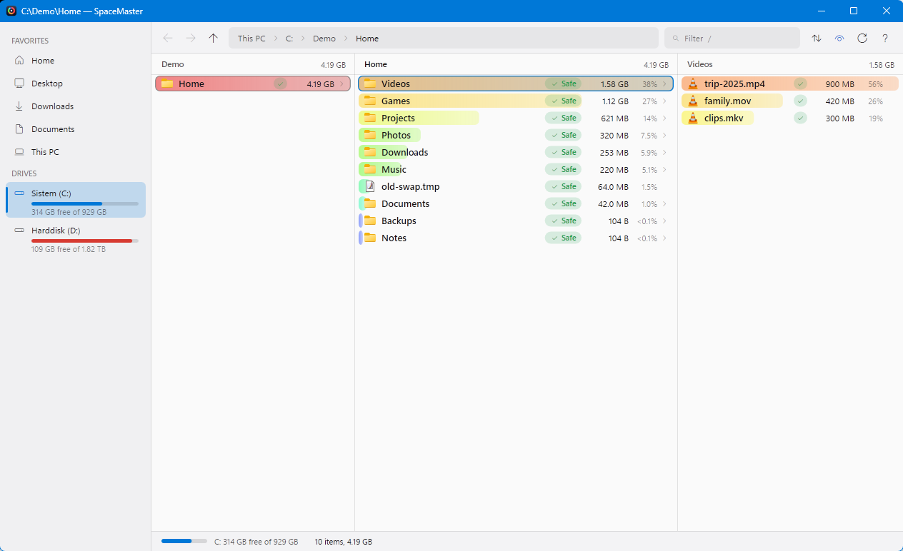
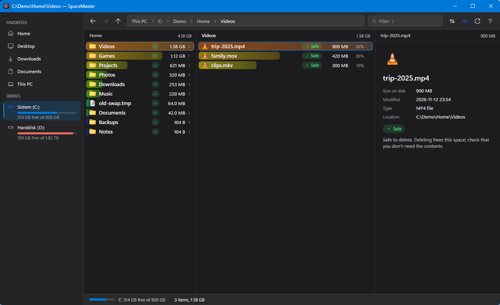
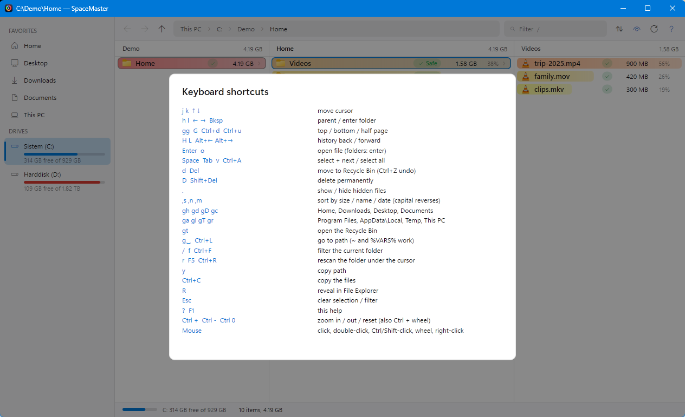

<h1 align="center">SpaceMaster for Windows</h1>

<p align="center">
A very fast, native disk-space manager for Windows 11.<br>
See at a glance which folders eat your disk, and delete them safely.
</p>

The Windows sibling of [SpaceMaster for macOS](https://github.com/cembaylam/SpaceMaster). Written in Rust, drawn with
Direct2D/DirectWrite, tuned for one machine (Ryzen 9 5950X, `target-cpu=native`): no compatibility baggage.

<p align="center"></p>
<p align="center"></p>

## Features

- **Instant sizes.** A multi-threaded scanner lists directories in bulk (`GetFileInformationByHandleEx`) and opens
  sub-folders relative to their parent handle. Sizes update live while scanning and the folder you open is scanned first.
  On the development machine: 3.8 M items / 578 GB on `C:` in ~14 s, a 1.7 M item profile in ~8.6 s.
- **Colored share bars.** Every row has a bar behind it: length = size relative to the biggest sibling, color from red
  (huge share) through green to blue (tiny). The bar stays visible under the cursor.
- **Safety badges.** Safe / Protected / Has safe items, with a tooltip explaining why. Windows, Program Files, the registry
  hive, DPAPI keys, `.ssh`, OneDrive roots and folders you cannot write to are protected.
- **Finder-like navigation.** Three Miller columns (parent | current | preview), sidebar with drives and usage, clickable
  breadcrumb, cursor memory, history, filter. Fully keyboard driven (vim keys, like FileMaster) and mouse friendly.
- **Safe deleting.** *Move to Recycle Bin* (Ctrl+Z restores it) or *Delete permanently* (confirmation, multi-threaded).
- Light and dark mode follow Windows, crisp pixel-snapped text, per-monitor DPI.

## Keyboard

| Keys | Action |
|---|---|
| `j` `k` / `↑` `↓` | move cursor |
| `h` `←` `Backspace` / `l` `→` | parent / enter folder |
| `gg` `G` · `Ctrl+d` `Ctrl+u` | top / bottom · half page |
| `H` `L` (`Alt+←` `Alt+→`) | history back / forward |
| `Enter` `o` | open file (folders: enter) |
| `Space` | open the built-in viewer (see below) |
| `Tab` · `v` · `Ctrl+A` | select + next · select all |
| `d` `Del` | move to Recycle Bin (`Ctrl+Z` undo) |
| `D` `Shift+Del` | delete permanently |
| `.` | show / hide hidden files |
| `,s` `,n` `,m` | sort by size / name / date (capital reverses) |
| `gh` `gd` `gD` `gc` `ga` `gl` `gT` `gr` `gt` | Home, Downloads, Desktop, Documents, Program Files, AppData\Local, Temp, This PC, Recycle Bin |
| `g␣` `Ctrl+L` | go to path (`~`, `%VARS%` work) |
| `/` `f` `Ctrl+F` | filter the current folder |
| `r` `F5` | rescan the folder under the cursor |
| `y` · `Ctrl+C` · `R` | copy path · copy files · show in File Explorer |

`?` or `F1` shows the list inside the app.

<p align="center"></p>

## Viewer (Space)

Everything is built in, no external programs. Like FileMaster, every file type has a viewer:

- **Images** (zoom, pan, fit, centered), **PDF** (Windows' own engine, continuous scroll, zoom), **video and audio**
  (LibVLC with fast keyframe seeking: `←/→` seek 10 s, hold to scrub smoothly (up to 8x), `Shift` 30 s, `Ctrl` 1 min,
  `0`-`9` jump to 0-90 %, `j/k` volume, `m` mute, `f` fullscreen, click or drag the bar).
- **Text and code** with syntax colors in Fira Code (virtualized, instant scrolling, `Ctrl+C` copies all),
  **Markdown and HTML** rendered (WebView2), **Word/Excel/PowerPoint/OpenDocument** text, **archive** contents
  (zip, 7z, tar, tar.gz/xz/bz2...), and a **hex view** for anything else.
- `n` / `p` next / previous file, `Esc` `q` or `Space` close, `+` `-` `0` zoom, `g` `G` top / bottom, `f` maximize.

The video engine (about 100 MB) is bundled by the installer; for development run `scripts\fetch-libvlc.ps1 -Source <dir>`
once (any VLC 3.x `win-x64` libvlc folder) or set `SM_LIBVLC_DIR`.

## Build, run, test

Requires Rust (stable, MSVC) and the Visual Studio C++ build tools.

```powershell
cargo run --release                       # build and launch
cargo test                                # 67 tests incl. a real-window UI self-test
cargo run --release --bin sm-bench -- C:\ --runs 3        # scanner benchmark
cargo run --release --bin sm-bench -- --stress 100000     # big-folder UI timings
.\scripts\package.ps1                     # dist\SpaceMaster-1.0.4-win-x64.zip
```

Tests: unit tests (formatting, safety rules, Recycle Bin parsing), scanner tests against an independent `std::fs` walk
(including junctions, rescans, ordering), controller tests (navigation, keys, sort, filter, delete/undo), and
`tests/ui_smoke.rs`, which starts the real window with `--selftest` and drives paint, keyboard, mouse, wheel, resize,
themes and deleting through the real message handler.

## How it works

- `enumerate.rs` bulk directory listing; `scanner.rs` worker threads over a LIFO stack, atomic size propagation up the
  ancestor chain, only directories are kept in memory.
- `safety.rs` Safe/Protected/Mixed rules; `fsops.rs` Recycle Bin (shell) + restore, parallel permanent delete.
- `browser.rs` UI-independent controller; `src/app.rs`, `gfx.rs` the Direct2D front end (only visible rows are drawn).

## Notes and limits

- Sizes are *allocated* bytes. Hard links are counted per path. Junctions and symlinks are not followed.
- The Recycle Bin does not free space until emptied; use *Delete permanently* for that.
- The release build always starts as administrator (UAC prompt) so every folder can be read; debug builds do not.
- The Safe badge is about system safety only. Always check that you don't need the contents.

## License

MIT. See [LICENSE](LICENSE).
